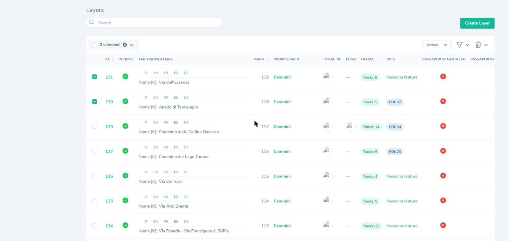
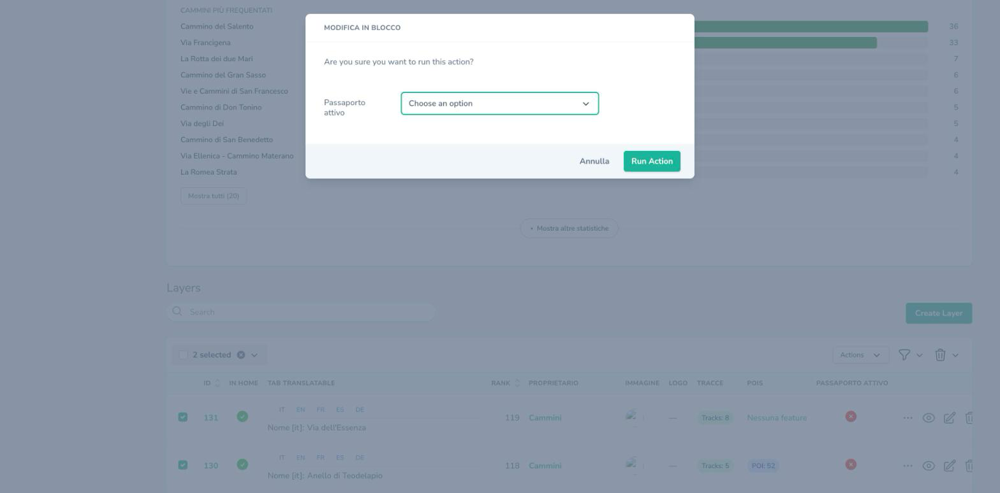

# Attivare e disattivare il Passaporto per ogni cammino

Il Passaporto del camminatore (timbri, avanzamento, richiesta di certificazione) si accende e si spegne **cammino per cammino**, direttamente dal pannello di amministrazione. Questa guida spiega come farlo e cosa succede nell'app.

Solo gli amministratori possono modificarlo.

## Due interruttori per ogni cammino

Ogni cammino ha due interruttori:

- **«Passaporto cartaceo»**: accende il Passaporto di quel cammino nell'app. I camminatori vedono timbri e avanzamento e possono chiedere la certificazione della credenziale cartacea, che il gestore approva o rifiuta dal pannello.
- **«Passaporto automatico (GPS)»**: in più, le tappe si sbloccano da sole dalle tracce GPS che il camminatore registra con l'app, senza bisogno della credenziale cartacea.

Le regole che legano i due interruttori:

- **Accendere il passaporto automatico accende anche quello cartaceo.**
- **Finché il passaporto automatico è acceso, quello cartaceo non si può spegnere**: per spegnere il Passaporto di un cammino, spegni prima il passaporto automatico.
- **Spegnere il passaporto automatico ferma lo sblocco automatico** su quel cammino, ma **le tappe già sbloccate restano**: una volta ottenuto, il timbro non si toglie. Da quel momento le nuove tappe si possono ottenere solo con la credenziale cartacea.

## Come funziona, in breve

- Al rilascio entrambi gli interruttori sono **spenti su tutti i cammini**.
- Finché **nessun cammino ha il passaporto cartaceo acceso**, nell'app la scheda «Passaporto» mostra soltanto un messaggio che dice che il servizio non è ancora attivo.
- Quando accendi il passaporto cartaceo di un cammino, chi usa l'app vede il Passaporto di quel cammino. Le persone lo vedono **la prossima volta che aprono l'app o rientrano nella sezione Passaporto**.
- Quando accendi il passaporto automatico, chi ha già camminato su quel cammino con l'app si ritrova le tappe sbloccate nel giro di qualche minuto.
- Quando spegni il passaporto cartaceo, il Passaporto del cammino non si vede più, ma **non si perde nulla**: tappe validate e richieste restano salvate e ricompaiono se lo riaccendi.

## Accendere o spegnere un singolo cammino

1. Nel menu del pannello, sotto **EC**, apri **Layers**: è l'elenco dei cammini.
2. Apri il cammino in modifica con l'icona a forma di matita.
3. Trova i due interruttori **«Passaporto cartaceo»** e **«Passaporto automatico (GPS)»**. Sotto ciascuno c'è un testo che ricorda cosa fa.
4. Spunta la casella per accendere (togli la spunta per spegnere) e salva. Se spunti il passaporto automatico, la casella del passaporto cartaceo si spunta da sola e non si può togliere.

## Accendere o spegnere più cammini insieme

Se devi cambiare molti cammini, usa la **modifica in blocco**.

1. Nell'elenco dei cammini (**Layers**) spunta la casella a sinistra di ciascun cammino che vuoi cambiare.
2. Apri il menu **«Actions»** in alto a destra dell'elenco e scegli **«Passaporto: modifica in blocco»**.

3. Si apre una finestra con i due campi **«Passaporto cartaceo»** e **«Passaporto automatico (GPS)»**. Ognuno ha tre scelte:
   - **Sì**: accende su tutti i cammini selezionati;
   - **No**: spegne su tutti i cammini selezionati;
   - **«Choose an option»** (campo vuoto): **nessuna modifica**. Lascia questa scelta sul campo che non vuoi toccare.
4. Conferma con il pulsante **«Run Action»** (oppure **«Annulla»** per chiudere senza cambiare nulla).

Se chiedi di spegnere il passaporto cartaceo su cammini che hanno il passaporto automatico acceso, **non viene modificato nessun cammino** e compare un messaggio con i nomi dei cammini da sistemare. Spegni prima il passaporto automatico su quei cammini, poi riprova.

## Prima di spegnere un cammino

Controlla che il cammino **non abbia richieste di certificazione in attesa**. Se ne esistono e spegni il passaporto cartaceo, il camminatore riceverà comunque la decisione per email, ma **non potrà vederla nell'app** finché il cammino resta spento. Conviene prima gestire le richieste in sospeso, poi spegnere.

Se spegni il passaporto cartaceo per errore, basta riaccenderlo: nulla è andato perso.

## Domande frequenti

**Ho acceso un cammino ma nell'app non vedo il Passaporto.**

Chiudi e riapri l'app, oppure esci e rientra nella sezione Passaporto: il cambiamento arriva in uno di questi momenti.

**Ho spento il passaporto cartaceo: i timbri dei camminatori sono andati persi?**

No. Tappe validate e richieste restano salvate e tornano visibili se riaccendi il cammino.

**Ho spento il passaporto automatico: cosa perdono i camminatori?**

Nulla: le tappe già sbloccate dal GPS restano. Da quel momento, però, su quel cammino nessuna nuova tappa si sblocca da sola: si ottengono solo con la credenziale cartacea.

**Perché non riesco a togliere la spunta dal passaporto cartaceo?**

Perché il passaporto automatico di quel cammino è acceso. Spegni prima quello.

**Perché nell'app vedo solo un messaggio?**

Perché nessun cammino ha ancora il passaporto cartaceo acceso. Accendine almeno uno.
